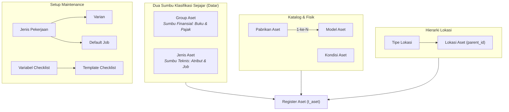
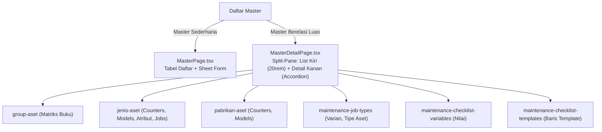

# Master data

Halaman ini untuk developer. Isinya arsitektur dan perilaku yang **dipakai bersama oleh seluruh master data** di modul aset — bukan sekadar penjelasan satu per satu.

Master data adalah daftar pilihan yang dipakai berulang di seluruh alur transaksi: `group-aset`, `jenis-aset`, `kondisi-aset`, `pabrikan-aset`, `model-aset`, `lokasi-aset`, `tipe-lokasi-aset`, `tipe-atribut`, `profil-penyusutan`, `buku-penyusutan`, tipe pekerjaan maintenance, dan master work order. Daftar lengkapnya ada di `routes/api/master-data.php` pada array `$masters`.

## Nama layar dan nama internal

Label Master diperbarui pada 13 Oktober 2026. Nama resource, tabel, kolom, controller, dan kode permission tetap mengikuti konsep yang disimpan. Gunakan pemetaan ini saat menelusuri layar ke backend; perubahan label tidak menggabungkan master atau mengubah perhitungan.

| Nama di layar | Resource atau kolom | Tabel | Controller di `src/Http/Controllers/master/` |
| --- | --- | --- | --- |
| Kelompok Aset | `kelompok-harta`, referensi `kelompok_harta_fiskal_id` | `aset_m_kelompok_harta_fiskal` | `AssetClassifications/AssetClassificationController.php` |
| Nilai Perolehan Non Penyusutan | `group-aset.capitalization_threshold` | `aset_m_group_aset` | `GroupAsetController.php` |
| Buku dan Metode Penyusutan | `buku-penyusutan` | `aset_m_buku_penyusutan` | `BukuPenyusutanController.php` |
| Metode Penyusutan | `profil-penyusutan` | `aset_m_profil_penyusutan` | `ProfilPenyusutanController.php` |
| Komponen Atribut Aset | `tipe-atribut` | `aset_m_tipe_atribut` | `TipeAtributController.php` |
| Setup Akun/COA Aset | `posting-group-aset` | `aset_m_posting_group` | `AssetPostingGroupController.php` |

**Kelompok Aset tetap referensi fiskal**, berbeda dari Group aset yang menentukan perlakuan finansial. **Nilai Perolehan Non Penyusutan tetap batas nilai per aset**, bukan nilai perolehan yang dicatat pada transaksi: perolehan di bawah batas tidak disusutkan; tepat pada batas sudah memenuhi syarat nilai untuk disusutkan. Saklar penyusutan pada matriks buku tetap berlaku.

**Metode Penyusutan tetap paket aturan**, termasuk frekuensi, masa manfaat, tarif, dan masa berlaku. Field `method` berlabel Cara perhitungan agar berbeda dari nama master. Buku tetap menunjuk paket aturan utama dan pengganti; tidak menyimpan salinan master metode.

**Komponen Atribut Aset tetap definisi ciri tambahan**, misalnya Bahan bakar dengan pilihan nilai yang dikelola tenant. Definisi dipasang pada Jenis aset; ini bukan daftar bagian fisik kendaraan dan tidak menambah relasi atribut pada Group aset.

Pada panel detail Master, Keterangan dan Aktif berada di Umum; bagian Lain-lain dihilangkan. Record baru dimulai aktif pada form daftar-detail maupun form lama, dengan fallback aktif di `MasterDataController`. Menyunting record nonaktif mempertahankan statusnya sampai pengguna mengubahnya. Pembagian bagian pada layar tidak mengubah payload atau skema.



---

## Fungsi tiap master

| Master | Menjawab | Dibahas di |
| --- | --- | --- |
| `group-aset` | Barang ini disusutkan bagaimana, masuk kelompok pajak apa | [Group aset](/apps/management-aset/master/groupaset/) |
| `jenis-aset` | Data teknis apa yang harus diisi, pekerjaan apa yang berlaku | [Jenis aset](/apps/management-aset/master/jenisaset/) |
| `tipe-atribut` | Hal apa saja yang bisa dicatat sebagai data tambahan | [Jenis aset](/apps/management-aset/master/jenisaset/) |
| `pabrikan-aset` | Barang ini buatan siapa | [Pabrikan dan model](/apps/management-aset/master/katalog-model/) |
| `model-aset` | Tipe barang dari pabrikan itu | [Pabrikan dan model](/apps/management-aset/master/katalog-model/) |
| `kondisi-aset` | Keadaan fisik barang sekarang (misal: Baik, Rusak Ringan, Rusak Berat) | Halaman ini |
| `tipe-lokasi-aset` | Golongan tingkatan lokasi: site, gedung, lantai, ruang | [Lokasi](/apps/management-aset/master/lokasi/) |
| `lokasi-aset` | Di mana barangnya berada, dan siapa yang menanggung biayanya | [Lokasi](/apps/management-aset/master/lokasi/) |
| `profil-penyusutan` | Rumus dan frekuensi menghitung penyusutan | [Penyusutan](/apps/management-aset/master/depresiasi/) |
| `buku-penyusutan` | Untuk keperluan apa penyusutan dihitung (Komersial/Fiskal) | [Penyusutan](/apps/management-aset/master/depresiasi/) |
| `maintenance-job-types` | Jenis pekerjaan perawatan fisik | [Setup maintenance](/apps/management-aset/master/maintenance/) |
| `maintenance-job-type-variants` | Turunan pekerjaan (misal: servis 10.000 km) | [Setup maintenance](/apps/management-aset/master/maintenance/) |
| `maintenance-job-type-defaults` | Nilai bawaan jam & alat saat pekerjaan dibuat | [Setup maintenance](/apps/management-aset/master/maintenance/) |
| `maintenance-checklist-variables` | Variabel yang diukur atau dinilai saat pemeriksaan | [Setup maintenance](/apps/management-aset/master/maintenance/) |
| `maintenance-checklist-templates` | Susunan baris pemeriksaan yang dipakai berulang | [Setup maintenance](/apps/management-aset/master/maintenance/) |
| `tipe-work-order` | Golongan work order dan batas satu pekerja | [Master work order](/apps/management-aset/master/work-order/) |
| `tingkat-layanan` | Urgensi penanganan (angka kecil = prioritas tinggi) | [Master work order](/apps/management-aset/master/work-order/) |
| `trade` | Bidang keahlian yang dibutuhkan (mekanik, elektrik) | [Master work order](/apps/management-aset/master/work-order/) |
| `sebab-kerusakan` | Akar penyebab kerusakan saat WO ditutup | [Master work order](/apps/management-aset/master/work-order/) |
| `tindakan-perbaikan` | Tindakan teknis yang dilakukan untuk memperbaiki | [Master work order](/apps/management-aset/master/work-order/) |
| `fixed-asset-parameters` | Parameter aset tetap satu tenant, padanan Fixed Asset Setup BC | [Parameter aset tetap](/apps/management-aset/master/pengaturan/) |
| `fixed-asset-posting-profiles` | Posting group aset: akun jurnal per group dan tanggal berlaku | [Posting group aset](/apps/management-aset/master/posting-group/) |

---

## Dua Pola Tata Letak UI di Frontend

UI master modul aset mengadopsi dua pola komponen tergantung kompleksitas relasi datanya:



1. **`MasterPage.tsx`**: Menampilkan tabel data satu layar penuh dengan Sheet drawer untuk penambahan dan pengeditan (dipakai oleh `kondisi-aset`, `tipe-lokasi-aset`, `trade`, `tingkat-layanan`, dll).
2. **`MasterDetailPage.tsx` & `RecordDetailPane.tsx`**: Menampilkan panel terbagi dua (*split-pane*). Panel kiri berisi daftar record yang dapat di-scroll tanpa batas (*infinite list*), dan panel kanan menampilkan formulir lengkap dengan accordion/sub-tab dinamis untuk mengelola entitas turunan tanpa berpindah halaman.

---

Form master sederhana ditutup setelah penyimpanan berhasil, lalu DataTable dimuat ulang. Panel daftar-detail menampilkan record hasil simpan dalam mode baca. Rincian dapat disusun sebelum record baru tersimpan, sehingga tidak perlu penyimpanan kedua untuk mengisinya.

### Satu penyimpanan per form

Bagian atribut, model, kondisi, counter, buku penyusutan, varian pekerjaan, checklist, serta baris dan objek rencana hanya menyusun draft. Simpan pada toolbar induk mengirim field master dan `details` dalam satu POST atau PATCH. Kegagalan satu bagian membatalkan seluruh transaksi; isian tetap tersedia untuk diperbaiki. Batal membuang draft. Dialog baris memakai Tambah atau Selesai untuk menerima perubahan ke draft induk, tanpa menulis ke database.

Model pabrikan dan varian pekerjaan mengirim operasi atas baris yang berubah beserta versi masing-masing, bukan mengganti seluruh daftar. Daftar dapat dimuat bertahap, sehingga baris yang belum dimuat tidak boleh dianggap dihapus. Hak create, update, dan archive anak tetap diperiksa. Bagian yang ditutup mempertahankan isian setelah pertama kali dibuka melalui `CollapsibleSection.keepMounted`.

`creation_payload_hash` mencatat hash kiriman awal pada master yang mendukung rincian. Retry dengan kunci sama dan isi berbeda mendapat `409 idempotency_conflict`, agar perubahan rincian setelah respons terputus tidak dianggap sudah tersimpan. Hash dibuat bersama record dalam transaksi yang sama; isi kiriman asli tidak disimpan pada kolom ini.

`SectionSaveOwnershipTest` menjaga pemilik tombol Simpan dan menolak request tulis mandiri dari komponen bagian master. `MasterDraftDetailsTest` menguji penyimpanan gabungan, rollback, izin, versi, kepemilikan anak, dan retry.

## Arsitektur Backend: Dua Base Controller

### 1. `MasterDataController` — Untuk Master Mandiri

Semua master mandiri tidak menulis ulang logika CRUD atau penomoran. Mereka hanya mewarisi `MasterDataController`:

```php
namespace Modules\Apperp\ManagementAset\Http\Controllers\master;

use Modules\Apperp\ManagementAset\Http\Controllers\MasterDataController;
use Modules\Apperp\ManagementAset\Models\master\Trade;

class TradeController extends MasterDataController
{
    protected function resource(): string { return 'trade'; }
    protected function model(): string { return Trade::class; }
}
```

Bila master memiliki induk atau anak, relasi dinyatakan melalui:
```php
protected function parentMasters(): array {
    return [
        new MasterParent('lokasi-aset', 'parent_id', 'parent', LokasiAset::class, required: false),
        new MasterParent('tipe-lokasi-aset', 'tipe_lokasi_id', 'tipe_lokasi', TipeLokasiAset::class, required: false),
    ];
}
```

### 2. `MasterLinkController` — Untuk Tabel Penghubung

Tabel matriks (misal: kaitan jenis aset ke model, kaitan job ke asset type, matriks group ke buku) mewarisi `MasterLinkController`.

| Karakteristik | Master Mandiri (`MasterDataController`) | Tabel Penghubung (`MasterLinkController`) |
| :--- | :--- | :--- |
| Punya kolom `kode` | Ya (Diterbitkan Core) | Tidak |
| Minta nomor ke Core | Ya | Tidak |
| Header `Idempotency-Key` | Wajib pada `POST` | Tidak (Metode `PUT` sudah idempoten) |
| Hak akses | Permission resource sendiri | Menggunakan permission milik entitas induk |
| Cara penyimpanan | Per satu record | Satu `PUT` mengganti seluruh array daftar |
| Mekanisme Konkurensi | Cek duplikasi unik creation key | Mengunci baris induk (*Pessimistic Lock*) |

---

## Lima Endpoint Standar Master

Setiap master mandiri mengekspos 5 rute REST yang konsisten:

| Metode & Endpoint | Permission | Gunanya |
| :--- | :--- | :--- |
| `GET /api/v1/{resource}` | `management-aset.{resource}.read` | Membaca daftar terpaginasi |
| `POST /api/v1/{resource}` | `management-aset.{resource}.create` | Membuat record baru (wajib `Idempotency-Key`) |
| `GET /api/v1/{resource}/{id}` | `management-aset.{resource}.read` | Membaca detail satu record |
| `PATCH /api/v1/{resource}/{id}` | `management-aset.{resource}.update` | Memperbarui kolom record |
| `DELETE /api/v1/{resource}/{id}` | `management-aset.{resource}.archive` | Soft delete / mengarsipkan record |

Permission berlaku per resource. Memiliki `group-aset.update` tidak memberikan izin mengubah `jenis-aset`.

---

## Aturan Bersama yang Dijaga

**Kode master bernomor selalu dari Core.** `POST` meminta nomor lewat `AssetNumberSequenceIssuer` dan kontrak `NumberSequenceIssuer` dalam transaksi penyimpanan master. Konfigurasi nomor yang belum aktif ditolak 422. Master boleh meneruskan kode manual bila pengaturan tenant mengizinkannya; kode kosong hanya otomatis bila `allow_automatic` aktif. Grup dan lokasi dibawakan ke manual saja. Kode yang sudah tersimpan tidak dapat diubah.

**`POST` wajib membawa `Idempotency-Key`.** Kunci disimpan di `creation_key` dengan batasan `unique(tenant_id, creation_key)` pada database. Kirim ulang kunci yang sama akan mengembalikan record yang sama dengan header `Idempotent-Replayed: true`.

**Induk lintas tenant ditolak database.** Foreign key selalu komposit `(tenant_id, parent_id) -> (tenant_id, id)`. Batasan integritas ditegakkan langsung oleh RDBMS, bukan sekadar validasi aplikasi.

**Pencegahan Siklus Relasi Hierarki.** Pada master yang menunjuk tabelnya sendiri (seperti `lokasi-aset`), rantai relasi melingkar (A $\rightarrow$ B $\rightarrow$ A) dideteksi dan ditolak oleh method `rejectParentCycle()`.

**Arsip Lunak (*Soft Delete*).** `DELETE` hanya mengisi timestamp `deleted_at`. Record yang sudah direferensikan dokumen transaksi historis tetap utuh dan konsisten, namun tidak lagi muncul pada dropdown pilihan baru.

---

## Di mana kodenya

| Berkas | Isinya |
| --- | --- |
| `src/Http/Controllers/MasterDataController.php` | Controller dasar seluruh master data |
| `src/Http/Controllers/MasterLinkController.php` | Controller dasar tabel penghubung / matriks |
| `src/Http/Controllers/master/` | Controller spesifik per master |
| `src/Models/master/` | Model Eloquent master |
| `src/Support/MasterParent.php`, `MasterChild.php` | Deklarasi metadata relasi induk-anak |
| `ui/master/MasterPage.tsx`, `MasterForm.tsx` | Layar master standar |
| `ui/master/detail/MasterDetailPage.tsx` | Layar master split-pane dua kolom |
| `ui/master/detail/RecordDetailPane.tsx` | Panel detail kanan ber-accordion |
| `ui/master/DynamicField.tsx` | Renderer kontrol field dinamis |

---

## Halaman terkait

- [Group aset](/apps/management-aset/master/groupaset/)
- [Jenis aset dan atribut](/apps/management-aset/master/jenisaset/)
- [Pabrikan dan model](/apps/management-aset/master/katalog-model/)
- [Lokasi aset](/apps/management-aset/master/lokasi/)
- [Penyusutan: profil dan buku](/apps/management-aset/master/depresiasi/)
- [Setup maintenance](/apps/management-aset/master/maintenance/)
- [Master work order](/apps/management-aset/master/work-order/)
- [Number sequence](/dev/14-number-sequences)
