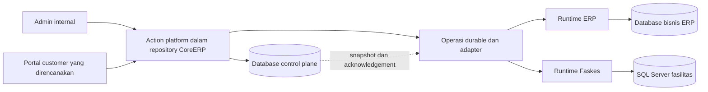

# Pemisahan database control plane

Program ini memisahkan data platform Metta dari data bisnis ERP. Database bernama `core_control_plane` menyimpan metadata control plane dan Organization Foundation bersama untuk ERP serta Faskes. ERP menyimpan ekstensi finansial legal entity, role bisnis, dan transaksi pada database aplikasi.

Status pada 2 November 2026 adalah **PRD dan rencana implementasi**. User menyetujui arah pemisahan database. Dokumen ini tidak berarti migration, cutover, perubahan runtime, atau aktivasi trial sudah dilakukan.

Agent pelaksana mulai dari [handoff implementasi](HANDOFF.md), kemudian menjalankan TODO dan gate pada urutan yang ditetapkan. Paket ini tidak memberi izin perubahan data produksi atau aktivasi trial otomatis.

Produk melayani Faskes pemerintah, swasta, yayasan, dan pengelola lain. Konsep serta identifier inti netral terhadap sektor. Studi kasus sumber bukan syarat organisasi customer; gunakan profil layanan dan policy yang dipilih, bukan jenis pengelola untuk menentukan proses otomatis.

| Dokumen                                                      | Tujuan                                                                   |
| ------------------------------------------------------------ | ------------------------------------------------------------------------ |
| [PRD](PRD.md)                                                | Menetapkan ruang lingkup, ownership, kebutuhan, dan acceptance criteria. |
| [TODO](TODO.md)                                              | Mengurutkan pekerjaan, dependensi, owner, dan bukti selesai.             |
| [Cutover dan rollback](CUTOVER.md)                           | Menetapkan prosedur yang harus dibuktikan sebelum database dialihkan.    |
| [Referensi dan materi belajar](REFERENCES.md)                | Menjelaskan pola resmi, penerapan pada Metta, serta batas kesimpulannya. |
| [Rencana portal customer](../metta-platform-portal/index.md) | Menggunakan hasil pemisahan untuk alur admin dan customer yang sama.     |

## Keputusan target

- Database control plane dipisah dari database bisnis ERP.
- Identity organisasi, operating-unit profile, hierarchy, dan metadata sharing mempunyai satu authority Foundation pada `core_control_plane`, tanpa pembelian ERP. Pasien, saldo stok, dan transaksi tetap di aplikasi pemiliknya.
- Repository dan bentuk deployment aplikasi tetap seperti sekarang untuk tahap ini. Ekstraksi service atau repository bukan bagian program.
- Database terpisah dapat menggunakan cluster PostgreSQL yang sama dahulu, dengan role serta batas koneksi berbeda. Ini belum merupakan isolasi host atau process seperti target resource isolation penuh Microsoft Azure.
- SSO tetap mengurus autentikasi. Faskes tetap menggunakan database SQL Server masing-masing. Tidak ada pemindahan data bisnis kedua produk ke database platform.
- Tidak membangun bridging ERP-Faskes sekarang. ID dan kontrak ownership disiapkan agar integrasi kelak tidak bergantung pada nama database, hostname, atau email.
- On-prem perpetual tetap dapat bekerja tanpa database control plane vendor.

Lihat [fondasi organisasi dan kebijakan sharing](ORGANIZATION-AND-SHARING.md) untuk kasus pasien terpisah tetapi stok bersama, grouping yang tidak mengikuti hierarchy, serta batas capability legacy. Lihat [TODO sharing](../metta-platform-portal/SHARING-TODO.md) untuk enforcement aplikasi; pekerjaan itu tidak otomatis selesai oleh split database.

[Profil kelompok layanan](SERVICE-GROUP-PROFILES.md) menetapkan pasien per kelompok unit utama/pendukung serta master obat/jasa bersama. [Bukti SQL Kuta 1 dan Mengwi 1](DATABASE-PATTERN-EVIDENCE.md) menjadi baseline pola legacy, bukan klaim seluruh data atau mekanisme sinkronisasi identik.

[Sumber stok, titipan DEPO dan pembayaran](SUPPLY-CUSTODY-AND-PAYMENT.md) menambahkan profile Apotek/Klinik dengan owner, custodian/lokasi, unit realisasi, seller, collector dan beneficiary yang berbeda. Kasus tersebut tidak diselesaikan hanya dengan satu stock pool atau satu UnitBisnisID.

Ini diagram target, bukan topologi runtime yang telah terpasang. Proses yang masih memegang credential dua database tetap mempunyai risiko bersama. Pemisahan database tidak boleh dipasarkan sebagai pemisahan process atau server.

## Hubungan dengan rencana portal

Urutan dependensi menjadi `CPDB-01 -> PF-01 -> CPDB-02 -> CPDB-03 -> CPDB-04 -> CPDB-05 -> PF-02`, kemudian PF-03 sampai PF-06 sesuai dependensi portal. PF-01 tetap satu pekerjaan untuk memisahkan penciptaan tenant dari bootstrap ERP, bukan pekerjaan baru yang diduplikasi oleh tim database.

Analisis desain dan prototype boleh berjalan paralel. Portal dengan kepemilikan baru tidak diaktifkan sebelum split database dan verifikasi integrasi lulus. Enrollment dan tenant yang dimatikan tetap mengikuti keputusan operasional terakhir.

## Prinsip yang dipakai

**Foundational Thinking** menempatkan inventaris ownership dan pemisahan routing sebelum pemindahan data. **Make Operations Idempotent** mewajibkan receipt dan retry yang aman ketika dua database tidak lagi berbagi transaksi. **Prove It Works** mewajibkan bukti `current_database()`, role akses, dan perilaku saat salah satu database tidak tersedia.
