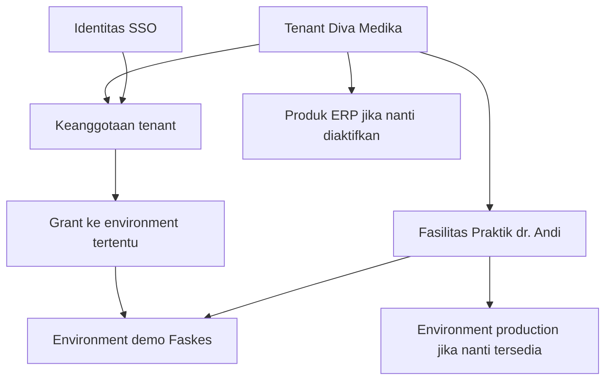

# Platform Metta dan portal customer

Rencana ini menyatukan pembuatan tenant dari admin internal dan portal customer. Customer membuat atau bergabung ke organisasi, lalu memakai fasilitas Faskes di bawah organisasi tersebut. Tim Metta mengelola organisasi dan fasilitas yang sama melalui konsol internal.

Status dokumen adalah **usulan implementasi**, diperbarui 2 November 2026. Arah pemisahan database control plane telah disetujui dan dirinci pada [PRD pemisahan](../control-plane-database/PRD.md). Ini bukan klaim bahwa portal, split database, undangan Faskes, atau pengaturan dinamis sudah tersedia. Enrollment dan DivaPraktik tetap mengikuti instruksi takedown terakhir; dokumen ini tidak mengaktifkannya.

## Mulai membaca

| Dokumen                                                                                 | Dipakai untuk                                                                                |
| --------------------------------------------------------------------------------------- | -------------------------------------------------------------------------------------------- |
| [Penjelasan ini](index.md)                                                              | Memahami model, batas sistem, dan alur kedua sisi.                                           |
| [Rencana pelaksanaan](PLAN.md)                                                          | Menjalankan unit perubahan beserta dependensi dan pemeriksaannya.                            |
| [TODO tim](TODO.md)                                                                     | Mencatat owner pekerjaan, status, penghambat, dan bukti selesai.                             |
| [Perubahan dan skenario mendatang](CHANGES.md)                                          | Mengubah kebijakan tanpa merusak environment berjalan atau rencana tim.                      |
| [Fondasi organisasi dan sharing](../control-plane-database/ORGANIZATION-AND-SHARING.md) | Menetapkan master bersama serta variasi pasien/katalog/stok yang independen dari hierarchy.  |
| [TODO sharing Faskes](SHARING-TODO.md)                                                  | Menjalankan enforcement legacy dan migration policy per capability yang benar-benar dirilis. |

## Bedakan tenant, fasilitas, dan environment

| Konsep         | Makna dan aturan                                                                                                                   |
| -------------- | ---------------------------------------------------------------------------------------------------------------------------------- |
| Identitas      | Orang yang login melalui SSO. Ikatan memakai `issuer + subject`, bukan email sebagai primary key.                                  |
| Client         | Record hubungan komersial yang sudah ada di CoreERP. Bukan OAuth client dan bukan tempat menaruh anggota tim.                      |
| Tenant         | Batas kepemilikan dan keanggotaan customer. UI boleh menyebutnya Organisasi. Identitasnya tetap saat namanya berubah.              |
| Fasilitas      | Identitas bisnis seperti Praktik dr. Andi atau Apotek Diva. Fasilitas punya profil layanan dan dapat mempunyai environment.        |
| Environment    | Tempat aplikasi berjalan, misalnya demo atau production. Menyimpan status operasional, penempatan, domain, dan referensi database. |
| Hak produk     | Hak organisasi memakai suatu produk. Hak ini tidak membuktikan aplikasi sudah terpasang atau siap dibuka.                          |
| Keanggotaan    | Hubungan orang dengan tenant. Hak mengelola tenant berasal dari security role, bukan kolom `system_role` baru.                     |
| Grant aplikasi | Hak anggota memakai environment tertentu. Keanggotaan saja tidak memberikan akses ke seluruh fasilitas.                            |

Tenant bukan root organization. Master `organizations` dan hierarchy menjadi fondasi generik bersama ERP/Faskes, bukan fitur yang mensyaratkan pembelian ERP. Fasilitas Faskes merujuk Organization ID yang relevan dengan ekstensi layanan, bukan membuat pohon organisasi kedua. Company setup finansial tetap milik ERP.

Untuk rilis portal pertama, satu fasilitas cukup satu environment trial. Ini bukan invariant satu unit fisik harus satu database. Satu environment Faskes dapat melayani beberapa unit ketika capability scope dan sharing-nya telah diuji. Identitas organisasi tetap terpisah dari environment; pemisahan registry pasien dan sumber stok ditentukan policy, bukan posisi hierarchy atau jumlah database.

## Simpan satu sumber kebenaran

| Pemilik                 | Data dan tanggung jawab                                                                                                                                            |
| ----------------------- | ------------------------------------------------------------------------------------------------------------------------------------------------------------------ |
| SSO                     | Credential, MFA, passkey, sesi identitas, dan akun autentikasi.                                                                                                    |
| Platform di CoreERP     | Principal lokal yang terikat SSO, client, tenant, membership, invitation, hak produk, fasilitas, registry environment, operasi provisioning, kebijakan, dan audit. |
| Organization Foundation | Master organisasi dan hierarchy, policy domain group dan revision pada core_control_plane; tersedia tanpa entitlement ERP.                                         |
| ERP                     | Ekstensi finansial legal entity/company, module, transaksi, dan role bisnis ERP. Master generik organisasi/hierarchy dimiliki Foundation.                          |
| Faskes                  | SQL Server fasilitas, master, pasien, transaksi, akun lokal, dan role bisnis. Adapter menerjemahkan grant platform menjadi akun lokal.                             |
| Landing                 | Informasi produk dan pintu masuk ke portal. Tidak menyimpan kepemilikan tenant atau membuat database.                                                              |

Database target bernama `core_control_plane`. Selain metadata provider, ia menampung domain Organization Foundation dengan master organisasi/hierarchy dan metadata sharing yang tenant-scoped. ERP/Faskes membaca kontrak atau projection lokal readonly; data pasien, stok dan transaksi tetap pada authority aplikasi. Repository/deployment belum dipisah, dan konsol tidak mempunyai migration sendiri.

Berbagi registry pasien tidak otomatis membuka rekam medis. Katalog obat bersama tidak berarti saldo stok bersama. Klinik A/B boleh memisahkan pasien tetapi memakai gudang pusat, sementara C mempunyai sumber sendiri. Pilihan tersebut hanya aktif jika adapter menegakkannya pada semua read/write, report, file, dan transaksi concurrent.

Pada [profil kelompok layanan](../control-plane-database/SERVICE-GROUP-PROFILES.md), customer dapat memilih pasien terpisah antar-kelompok, katalog bersama, dan unit pendukung yang mengikuti policy kelompoknya. Profile tersebut berlaku bagi pengelola pemerintah dan swasta. Customer mandiri tidak memerlukan parent fiktif. Jumlah unit tidak otomatis menentukan jumlah database.

SSO tetap global. Jangan membuat tenant SSO per fasilitas, client OIDC per customer, atau menjadikan grup SSO sebagai salinan keanggotaan tenant. Token login membuktikan identitas; platform memutuskan akses organisasi dan aplikasi.

## Alur customer

1. Customer masuk dari landing atau langsung ke portal, lalu login SSO.
2. Platform menyelesaikan konteks undangan terlebih dahulu. Akun penerima yang sah bergabung ke tenant yang mengundangnya.
3. Jika sudah menjadi anggota, portal membuka tenant terakhir yang masih sah atau menampilkan pemilih tenant.
4. Jika belum mempunyai keanggotaan atau undangan, portal meminta nama organisasi. Platform membuat tenant dan memberi pembuatnya role Owner melalui security role.
5. Customer memilih Faskes, profil Praktik Dokter, Apotek, atau Klinik, nama fasilitas, dan alamat aplikasi yang tersedia.
6. Platform memeriksa hak, kuota, nama, dan kapasitas. Platform mencatat operasi sebelum menjalankan provisioner.
7. Portal menampilkan progres, kegagalan yang dapat ditindaklanjuti, dan tombol Buka setelah pemeriksaan kesiapan selesai.
8. Owner mengundang anggota dan memberi grant aplikasi. Setiap anggota memakai akun lokal Faskes masing-masing.

Nama organisasi dan fasilitas boleh sama pada pendaftaran pertama, tetapi ID-nya berbeda. Undang anggota tidak wajib sebelum mencoba aplikasi sendiri. Login ulang dan refresh melanjutkan keadaan yang tersimpan, bukan memulai provisioning baru.

## Alur admin internal

1. Operator mencari tenant yang sudah ada sebelum membuat tenant baru.
2. Operator membuat atau memilih tenant. Operator tidak otomatis menjadi Owner customer.
3. Jika calon Owner belum terhubung, platform menyimpan undangan kepemilikan yang masih pending. Identitas tidak boleh diklaim hanya karena email record cocok.
4. Operator dapat menyiapkan fasilitas sebelum undangan diterima. Akses customer tetap menunggu keanggotaan dan grant yang sah.
5. Operator melihat status operasi, mencoba ulang langkah yang gagal, dan menangguhkan fasilitas dengan alasan serta audit.

Kedua sisi memakai tindakan domain yang sama untuk pembuatan tenant, undangan, fasilitas, dan provisioning. Adapter HTTP, izin, dan pelakunya berbeda. Override operator harus eksplisit, beralasan, dan tercatat; bukan cabang tersembunyi yang melewati aturan isolasi.

## Batas keamanan

- Owner tenant tidak menjadi operator Metta atau admin global SSO.
- Role pengelola organisasi tidak otomatis memberi seluruh akses klinis di setiap fasilitas.
- Role Owner ERP yang sudah ada tetap mengikuti `OwnerRoleDuties`. Jangan meneruskan seluruh duty ERP menjadi role klinis Faskes; grant dan pemetaan akun Faskes merupakan pemeriksaan terpisah.
- Undangan mengikat tenant, penerima yang diverifikasi, grant, inviter, masa berlaku, dan token sekali pakai. Ikatan akhir memakai subject SSO yang terverifikasi.
- Setiap anggota masuk dengan identitas lokal sendiri. Shared `owner` bukan jalur undangan tim.
- Akun dukungan `metta` tetap terpisah, terlindungi, dan diaudit. Tidak dipakai customer atau akun uji bersama.
- Pencabutan anggota menutup grant, sesi aplikasi, dan jalur login lokal yang diberikan oleh grant tersebut. Akun SSO global dan keanggotaan tenant lain tetap ada.
- Tolak penghapusan atau penonaktifan Owner terakhir. Pergantian Owner memakai penerimaan pemilik baru dan audit.
- Restore backup tidak boleh mengembalikan akses anggota yang sudah dicabut. Lakukan rekonsiliasi terhadap otoritas platform sebelum membuka kembali aplikasi.

## Keadaan source yang menjadi dasar

Pemeriksaan ini berdasarkan checkout CoreERP `c814b01ed9608b09b13a9dfe637d6094c723ea6a` dan source SSO yang dibaca pada penyusunan rencana. Ini bukan audit runtime terbaru.

| Keadaan yang ditemukan                                                    | Sumber dan dampak                                                                                                                                                 |
| ------------------------------------------------------------------------- | ----------------------------------------------------------------------------------------------------------------------------------------------------------------- |
| Tenant, membership, dan environment sudah ada.                            | `apps/core/app/Platform/Tenant/Models/` dan `Platform/Environment/Models/`. Pakai konsep kanonik tersebut.                                                        |
| Penciptaan tenant kanonik telah dipisahkan dari bootstrap ERP pada PF-01. | [Implementasi dan batas bukti PF-01](PF-01.md). Jalur registrasi ERP tetap memasang ERP secara eksplisit; runtime server belum dideploy.                          |
| Faskes dimiliki langsung oleh satu `ProductCustomer`.                     | `Platform/ControlPlane/Products/ProductRegistration.php`. Session mengambil satu instance terakhir dan launch menargetkan `owner`.                                |
| Jalur operator dan public Faskes memakai creator bersama.                 | `Platform/ControlPlane/Products/CreateProductTenant.php`. Pertahankan aturan domain bersama saat migrasi.                                                         |
| Kuota Faskes masih satu trial per orang dan produk.                       | Creator serta migration `2026_10_25_100000_add_product_customer_registration.php`. Ubah bersamaan dengan aturan anti-penyalahgunaan, bukan cukup menghapus index. |
| SSO didesain untuk autentikasi global.                                    | Repository SSO, `AGENTS.md` dan migration `2026_08_24_160800_remove_tenants_and_tenant_id_columns.php`. Tidak perlu membangun direktori organisasi SSO baru.      |

## Pisahkan database sebelum memperluas portal

Saat ini runtime masih memakai database bersama sebagaimana baseline yang dicatat. Target disepakati adalah database platform terpisah dari bisnis ERP, sementara repository dan bentuk deployment tetap. Portal customer direncanakan mempunyai route, session, permission, dan layout sendiri. Jangan memasukkannya ke route operator konsol.

Ikuti urutan `CPDB-01 -> PF-01 -> CPDB-02 -> CPDB-03 -> CPDB-04 -> CPDB-05 -> PF-02`, lalu unit portal berikutnya. Pekerjaan PF-01 dipakai bersama, bukan ditulis dua kali. [TODO pemisahan](../control-plane-database/TODO.md) mengunci manifest, koneksi, role, proyeksi, cutover, dan rollback.

Tunda hanya ekstraksi service/repository sampai ada bukti kebutuhan rilis independen atau operasional tim. Pemisahan database sudah menjadi target sekarang. Data role bisnis tetap lokal; pengelolaan organisasi dan environment menjadi authority platform. Bridging transaksi ERP-Faskes tetap di luar scope kedua program.

Faskes legacy adalah produk yang dikelola adapter. Ia bukan pembenaran untuk membuat module ERP baru sebagai aplikasi terpisah. Aturan module CoreERP yang sudah ada tetap berlaku.

Public trial ERP tetap nonaktif. Struktur portal dapat mengenal produk berikutnya tanpa menawarkannya ke customer sebelum adapter dan kebijakan produk itu siap.

## Referensi

- [Konsol dan batas data pusat](../../dev/31-admin-erp-control-plane.md).
- [Identity, role, dan invitation CoreERP](../../dev/09-identity-and-access.md).
- [SSO CoreERP](../../dev/32-sso.md).
- [Model tenant Microsoft Entra](https://learn.microsoft.com/en-us/entra/identity/multi-tenant-organizations/overview).
- [Pembuatan tenant Microsoft](https://learn.microsoft.com/en-us/entra/fundamentals/create-new-tenant).
- [Environment Power Platform](https://learn.microsoft.com/en-us/power-platform/admin/environments-overview).
- [Undangan dan penugasan aplikasi Entra](https://learn.microsoft.com/en-us/entra/external-id/b2b-quickstart-add-guest-users-portal).
